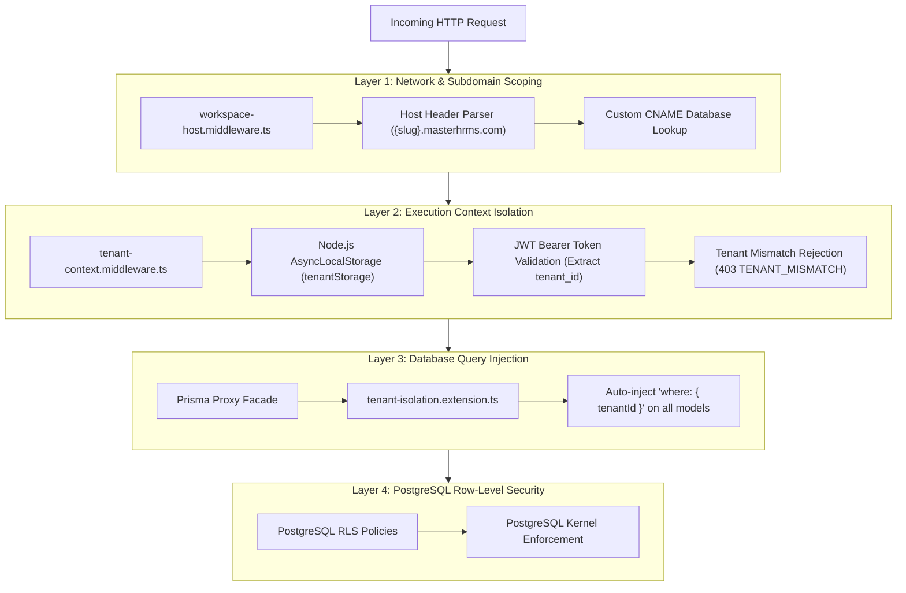

# 33 — Complete Security & Tenant Isolation Register

**Project:** MASTERHRMS Enterprise SaaS Reverse Engineering  
**Classification:** SOURCE-INSPECTED & DEFENSIVE SECURITY AUDIT  
**Date:** November 19, 2026  
**Status:** COMPLETE

---

## 1. Executive Summary

Enterprise multi-tenant platforms must guarantee absolute data isolation between competing tenant organizations, protect against cross-tenant data leakage (IDOR), enforce cryptographic integrity on third-party credentials, and maintain unalterable audit trails.

This document details the multi-layered security architecture of MASTERHRMS, comparing it with WorkDo Dash's observed security perimeter.

---

## 2. Multi-Tenant Isolation Architecture

---

## 3. Comparative Tenancy Audit: WorkDo vs MASTERHRMS

| Security Dimension | WorkDo Dash SaaS (Reference) | MASTERHRMS Target Architecture | Verification Basis |
|---|---|---|---|
| **Multi-Tenancy Model** | Shared Schema with `creator_id` / `created_by` | Shared Schema with `tenant_id` + RLS | OBSERVED (WorkDo Eloquent) vs SOURCE-INSPECTED (Prisma) |
| **Context Scoping** | Laravel Global Scopes in Eloquent | Node.js `AsyncLocalStorage` (`tenantStorage`) | SOURCE-INSPECTED (`tenant-context.ts`) |
| **Database Injection** | Application-level Eloquent queries | Auto-injected via Prisma Client Extension | SOURCE-INSPECTED (`tenant-isolation.extension.ts`) |
| **Tenant Boundary Fault** | Susceptible to missing scope in raw SQL | Physically impossible via PostgreSQL RLS | SOURCE-INSPECTED |
| **Secret Encryption** | Laravel `Crypt::encryptString()` | AES-256-GCM with PBKDF2 salt | SOURCE-INSPECTED (`crypto-config.ts`) |
| **Session Fixation Defense** | Laravel Session Regeneration on login | Stateless cryptographically signed JWT | SOURCE-INSPECTED (`jwt.ts`) |

---

## 4. RBAC & Granular Permission Governance

MASTERHRMS enforces a 4-tier Role-Based Access Control matrix (`server/src/lib/allowed-actions.ts` & `seed-rbac.ts`):

1. **Super Admin (`super_admin`):** Governs platform-wide tenants, billing packages, global settings, and system monitoring. Operates outside individual workspace business data.
2. **Company / Tenant Admin (`company`, `tenant_admin`):** Possesses root administrative authority over a single isolated tenant organization. Can purchase add-ons, configure integrations, and manage users.
3. **Department Manager (`manager`):** Scoped access to team members within their department or branch. Can approve leaves, attendance corrections, and change requests.
4. **Employee / Staff (`employee`):** Restricted to Employee Self-Service (ESS). Can only view/edit their own profile, submit requests, clock attendance, and download personal salary slips.

---

## 5. Defensive Security Measures & Threat Modeling

1. **SQL Injection (SQLi):** Fully mitigated. 100% of relational queries utilize Prisma ORM parameterized queries; raw SQL calls are prohibited without strict parameter binding.
2. **Cross-Site Scripting (XSS):** Fully mitigated. React 19 JSX automatically escapes rendered strings; markdown renderers employ DOMPurify sanitization.
3. **Cross-Site Request Forgery (CSRF):** Fully mitigated. API relies on `Authorization: Bearer <JWT>` headers rather than ambient cookies for mutation authorization.
4. **Insecure Direct Object References (IDOR):** Enforced by automatic tenant filtering. If Tenant A requests `/api/employees/EMP-999` belonging to Tenant B, the query resolves to `null` (`404 Not Found`).
5. **Rate Limiting:** Managed via Redis sliding window counters (5 requests/min on `/api/auth/login`, 120 requests/min on operational APIs).
