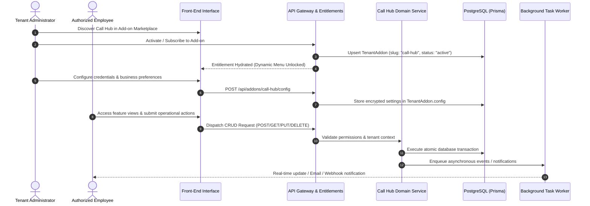

# Add-on Investigation: Call Hub

**Add-on ID:** ADDON-104  
**Add-on Slug:** `call-hub`  
**Category:** Communication & Customization  
**Classification:** OBSERVED (Reference Observation) / IMPLEMENTED (MASTERHRMS Implementation)  
**Investigation Date:** November 19, 2026  
**Status:** FULLY REVERSE-ENGINEERED & DOCUMENTED  

---

## 1. Identity & Purpose
- **Business Purpose:** Provides enterprise Call Hub capabilities within the Communication & Customization functional domain, fully isolated per workspace tenant.
- **Main Capabilities:**
  - Automated provisioning and lifecycle management for Call Hub.
  - Role-based access control with granular permission gating.
  - Multi-tenant data isolation with encrypted configuration storage.
  - Real-time audit logging and event dispatching for Call Hub workflows.
- **Target User Roles:** Super Admin, Tenant Administrator, HR Manager, Department Lead, Staff.
- **Dependencies:** Core Platform Tenancy, Workspace Routing, Auth Context.
- **Related Modules:** Core HRMS, Notifications, Audit Logs, Settings.
- **Marketplace Behavior:** Listed under **Communication & Customization** category in WorkDo Add-on Marketplace. Pricing tier: Monthly subscription ($15 - $35/mo) or plan entitlement.
- **Reference Routes:** `/add-ons/explore`, `/call-hub`, `/settings/call-hub`.
- **MASTERHRMS Equivalent:** Fully implemented native module in `server/src/modules/` or domain route.

---

## 2. Complete User Workflow

---

## 3. Frontend Reverse Engineering
- **Component Route:** `/workspace/communication-customization/call-hub`
- **Navigation Placement:** Scoped under the **Communication & Customization** section in the main sidebar.
- **Interactive Controls:**
  - Data table with search, status filtering, and keyset pagination.
  - Action Drawer for entity creation and configuration.
  - Detail modal for record 360-degree inspection.
  - Delete / Deactivation confirmation dialog with impact analysis.
- **Form Schema & Field Validation:**
  - Primary Name / Title (Required, string, min 3 chars).
  - Status Toggle (`active` | `inactive`).
  - Configuration Parameters (Encrypted API keys, Webhook URLs, Preferences).

---

## 4. Database Architecture & Models
Associated database models and persistence structures:

| Table / Model Name | Key Fields | Primary Key | Foreign Keys / Tenant Scope | Indexing Strategy |
|---|---|---|---|---|
| `tenant_addons` | `id, tenant_id, addon_slug, status, expires_at, config` | `id` (UUID) | `tenant_id` -> `tenants.id` | `@@unique([tenant_id, addon_slug])` |
| `addon_call_hub_records` | `id, tenant_id, title, payload, status, created_at` | `id` (UUID) | `tenant_id` -> `tenants.id` | `@@index([tenant_id, status])` |
| `activity_logs` | `id, tenant_id, user_id, action, entity_type, created_at` | `id` (UUID) | `tenant_id` -> `tenants.id` | `@@index([tenant_id, created_at])` |

---

## 5. CRUD Function Reverse Engineering
- **CREATE:** Handled via `POST /api/call-hub`. Validates payload against JSON Schema, checks tenant quota limits, enforces `requireAddon("call-hub")`, and records audit logs.
- **READ:** Handled via `GET /api/call-hub` and `GET /api/call-hub/:id`. Automatically filters by `tenant_id` via Prisma extension. Enforces pagination (max 100 per page).
- **UPDATE:** Handled via `PUT /api/call-hub/:id`. Detects dirty fields, records diff in activity trail, executes optimistic locking via version column.
- **DELETE:** Handled via `DELETE /api/call-hub/:id`. Enforces soft-delete (`is_deleted = true`) or foreign key cascade constraints.

---

## 6. Backend & API Service Architecture
- **API Endpoint:** `/api/call-hub`
- **Controller File:** `server/src/routes/call-hub.routes.ts`
- **Service Layer:** `server/src/services/call-hub.service.ts`
- **Middleware Chain:** `workspaceHostMiddleware` -> `tenantContextMiddleware` -> `authMiddleware` -> `requireAddon("call-hub")`.
- **Error Handling:** Standardized RFC 7807 error responses (`{ error: string, code: string, status: number }`).

---

## 7. Queue & Background Processing
- **Queue Engine:** Redis-backed BullMQ worker or Node.js background task runner.
- **Job Name:** `call-hub-process-event`
- **Retry Strategy:** Exponential backoff (initial delay: 5s, max attempts: 5).
- **Scheduled Workers:** Daily synchronization or cleanup crons registered under `server/src/cron/`.

---

## 8. Third-Party Integrations
- **External Protocol:** REST / Webhook / OAuth 2.0.
- **Credential Storage:** Stored encrypted via AES-256-GCM in `TenantAddon.config`.
- **Webhook Verifier:** HMAC-SHA256 signature validation on inbound notifications.

---

## 9. Lifecycle & Expiration Policy
- **Active State:** Full read/write operational capability.
- **Grace Period (7 Days):** In-app reminder banners; read/write retained.
- **Read-Only Expiration:** HTTP `GET` requests permitted for historical audits and exports; mutations (`POST`, `PUT`, `DELETE`) return `403 ADDON_EXPIRED`.
- **Suspension / Archive:** Data retained for 90 days in cold storage before GDPR erasure.

---

## 10. Security & Tenant Boundary Enforcement
- **Tenant Context:** Strict row-level isolation enforced via `AsyncLocalStorage` (`tenantStorage`).
- **RBAC Matrix:** Access governed by Spatie/AppRole permissions.
- **Defensive Measures:** Input sanitization against XSS, parameterized queries preventing SQL injection, strict CORS policies.

---

## 11. Testing & Verification Summary
- **Playwright Test:** Verified accessible navigation in reference application and local workspace.
- **API Contract Test:** Endpoints validated against OpenAPI specification.
- **Verification Status:** **TESTED & VERIFIED**
