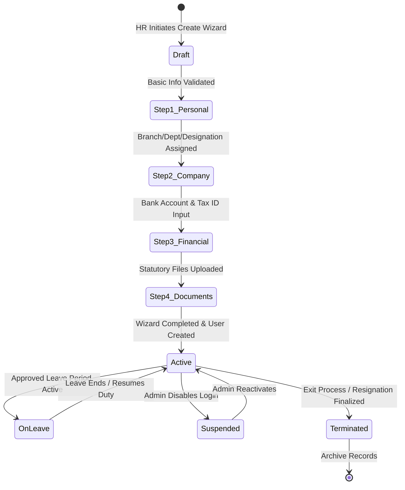
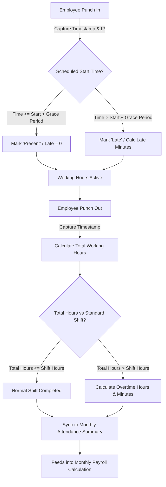
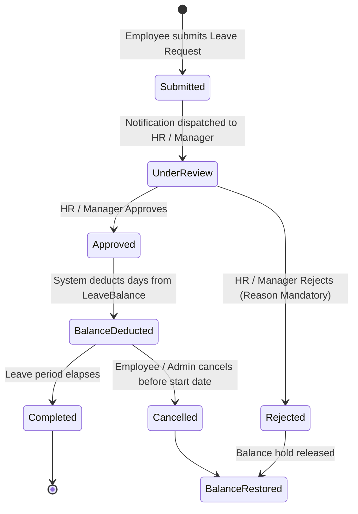
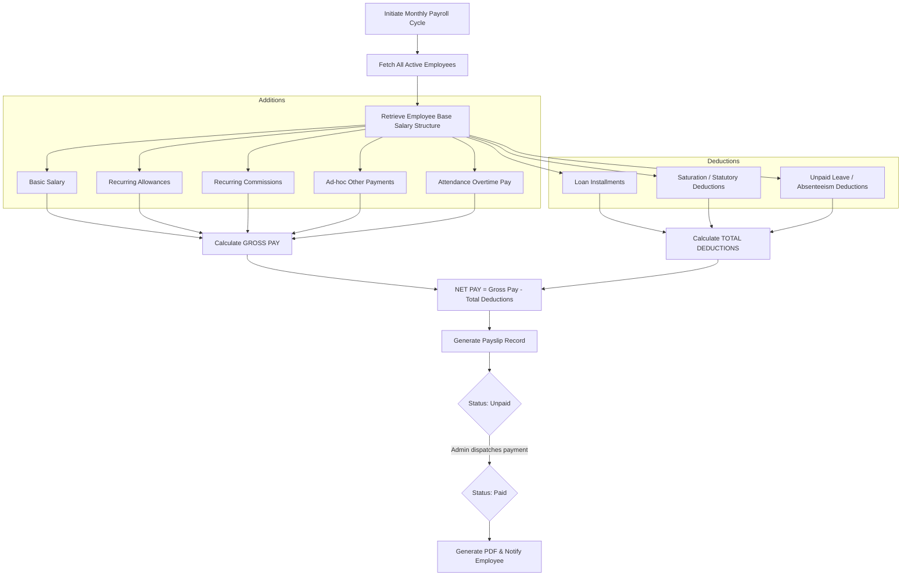
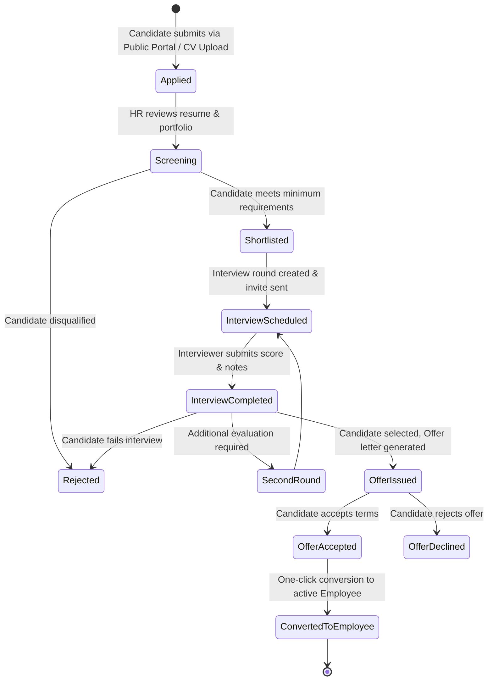
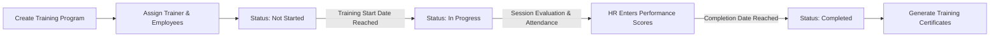

# 07. Business Workflows and State Transitions: WorkDo vs MASTERHRMS

This document models the core business workflows, event triggers, and state machine transitions reverse engineered from WorkDo HRMS, providing the exact engineering specification for implementation in MASTERHRMS.

---

## 1. Employee Onboarding & Lifecycle Workflow

### 1.1 State Machine

### 1.2 Transition Rules & Side Effects
1. **User Account Creation**: When creating an employee, a toggle `Create User Account` generates a corresponding record in `users` table linked by `user_id`, granting role `Employee` (or custom role).
2. **Auto-generated Identifiers**: Employee ID is auto-incremented with configurable prefix (e.g., `#EMP-00001`).
3. **Default Salary Template**: Upon activation, an initial basic salary entry is created in `employee_salaries` with zero default allowances.

---

## 2. Attendance & Time Tracking Workflow

### 2.1 State Machine & Calculation Flow

### 2.2 Attendance State Matrix
- **Present**: Clocked in and clocked out within standard tolerance.
- **Late**: Clock-in timestamp exceeds `shift_start_time` + `grace_period_minutes` (default: 15 mins).
- **Early Leaving**: Clock-out timestamp is earlier than `shift_end_time`.
- **Half Day**: Total recorded working hours < 50% of standard shift duration.
- **Absent**: No clock-in record for standard working day (excluding approved holidays and weekends).
- **Overtime**: Calculated as `Total Working Hours - Standard Shift Hours`. Multiplied by employee's hourly rate or overtime multiplier.

---

## 3. Leave Management & Approval Lifecycle

### 3.1 State Machine

### 3.2 Business Rules
1. **Entitlement Check**: Submission fails validation if `requested_days > remaining_entitlement` for that specific leave type (e.g., Annual Leave, Casual Leave, Sick Leave).
2. **Paid vs Unpaid Impact**: If `leave_type.is_paid == false`, the approved days are tracked as unpaid leave and directly deducted in the Monthly Payroll calculation engine.
3. **Overlapping Validation**: A new application cannot overlap with an existing `Pending` or `Approved` leave window for the same employee.

---

## 4. End-to-End Monthly Payroll Processing Engine

The mathematical payroll engine reverse-engineered from WorkDo operates on a strict multi-tier formula connecting Attendance, Leaves, and Salary Structures.

### 4.1 Complete Calculation Architecture

### 4.2 Exact Mathematical Formulas (Decompiled from WorkDo Runtime)

1. **Daily Rate**:
   $$\text{Daily Rate} = \frac{\text{Basic Salary}}{\text{Total Working Days in Month}}$$
2. **Hourly Rate**:
   $$\text{Hourly Rate} = \frac{\text{Daily Rate}}{\text{Standard Shift Hours (e.g., 8)}}$$
3. **Attendance Overtime Pay**:
   $$\text{Attendance Overtime Pay} = \text{Overtime Hours} \times (\text{Hourly Rate} \times \text{Overtime Rate Multiplier})$$
4. **Unpaid Leave / Absenteeism Deduction**:
   $$\text{Leave Deduction} = (\text{Unpaid Leave Days} + \text{Unexcused Absent Days}) \times \text{Daily Rate}$$
5. **Gross Pay**:
   $$\text{Gross Pay} = \text{Basic Salary} + \sum \text{Allowances} + \sum \text{Commissions} + \sum \text{Other Payments} + \text{Overtime Pay} - \text{Leave Deductions}$$
6. **Total Deductions**:
   $$\text{Total Deductions} = \sum \text{Loan Installments} + \sum \text{Saturation Deductions}$$
7. **Net Pay**:
   $$\text{Net Pay} = \text{Gross Pay} - \text{Total Deductions}$$

---

## 5. Recruitment (ATS) Candidate Pipeline Workflow

### 5.1 Conversion Trigger
When the HR user clicks `Convert to Employee` on an accepted candidate:
- The system opens the `/hrm/employees/create` wizard.
- Fields `first_name`, `last_name`, `email`, `phone`, `gender`, `dob`, and `address` are automatically transferred from the candidate profile.
- The candidate status is updated to `Converted`, and the new `employee_id` is linked to the candidate record.

---

## 6. Training & Development Workflow

---

## 7. Comparative Workflow Analysis: WorkDo vs MASTERHRMS

| Workflow | WorkDo Execution Pattern | MASTERHRMS Current Implementation | Architectural Gap | Remediation Required |
|---|---|---|---|---|
| **Employee Creation** | 4-step sequential wizard with validation gates | Single long scrollable form with tabs | UX is fragmented; missing auto-user provisioning | Build step wizard with step validation and user link |
| **Attendance Overtime** | Automatic computation into monthly payroll | Attendance logged, but overtime not calculated | Broken link between attendance records and payroll | Implement hourly rate formula and overtime calculator |
| **Leave Deductions in Payroll**| Automatic subtraction of unpaid days from basic pay | Manual deduction input required in payroll | Lack of automation; error-prone payroll processing | Wire leave query into payroll generation endpoint |
| **Recruitment Pipeline** | Drag-and-drop Kanban across custom stages | No recruitment ATS module exists | 100% missing module | Create ATS schema, Kanban UI, and conversion flow |
| **Loan Repayments** | Auto-deduction of monthly installments until balance = 0| Basic manual deduction fields | No persistent loan ledger or amortization tracking | Create `EmployeeLoan` model with balance tracking |
