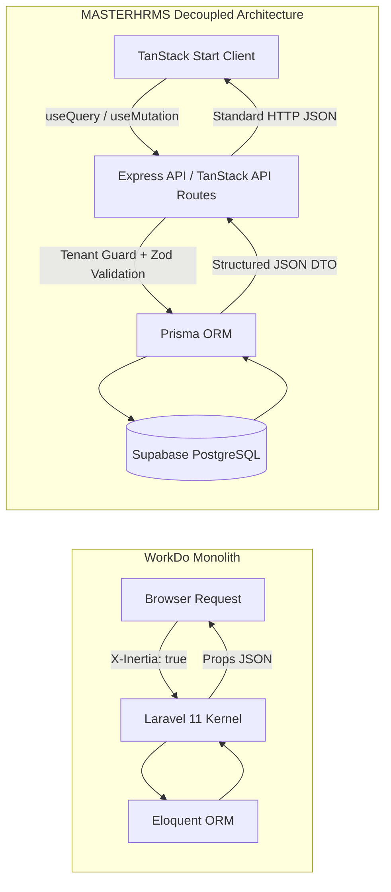

# 08. API and Network Inventory: WorkDo vs MASTERHRMS

This document catalogs the complete network and API landscape reverse engineered from WorkDo HRMS, including the Inertia.js protocol mechanics, route catalog, payload structures, and architectural mapping to MASTERHRMS's RESTful and TanStack Start API architecture.

---

## 1. WorkDo Network Architecture & Inertia.js Protocol

WorkDo does not use a decoupled JSON REST or GraphQL API for its primary web application. Instead, it utilizes **Inertia.js** running over Laravel 11 with Vite.

### 1.1 Request / Response Mechanics
1. **Initial Full-Page Load**:
   - Standard HTTP GET request.
   - The server returns an HTML skeleton containing `<div id="app" data-page="..."></div>`.
   - The `data-page` attribute contains an encoded JSON string with:
     ```json
     {
       "component": "Hrm/Employees/Index",
       "props": { ... },
       "url": "/hrm/employees",
       "version": "6c45b8e9..."
     }
     ```
2. **Client-Side Transitions & Form Submissions**:
   - Subsequent navigations and submissions are XMLHttpRequests / Fetch calls.
   - Request Headers:
     - `X-Inertia: true`
     - `X-Inertia-Version: <hash>`
     - `X-Requested-With: XMLHttpRequest`
     - `X-CSRF-TOKEN: <token>`
   - Server Response:
     - Pure JSON payload containing updated `component` and `props`.
     - Status 200 OK (or 302 Redirect following mutations).
     - Response Header: `X-Inertia: true`.

---

## 2. Complete Endpoints Catalog

### 2.1 Super Admin Routes

| HTTP Method | Route URL | Inertia Component | Payload / Query Parameters | Response / Behavior |
|---|---|---|---|---|
| `GET` | `/dashboard` | `Dashboard/SuperAdmin` | None | Returns tenant counts, revenue charts, recent orders |
| `GET` | `/companies` | `Companies/Index` | `?page=1&search=&status=` | Paginated company tenants list |
| `POST` | `/companies` | N/A (Redirect) | `{ name, email, password, domain }` | Creates new tenant & redirects to `/companies` |
| `GET` | `/companies/{id}/edit`| `Companies/Edit` | Route param: `id` | Tenant detail & quota configuration |
| `PUT` | `/companies/{id}` | N/A (Redirect) | `{ name, email, plan_id, max_users }`| Updates tenant settings |
| `DELETE` | `/companies/{id}` | N/A (Redirect) | None | Soft-deletes or drops tenant schema |
| `GET` | `/impersonate/company/{id}`| N/A (Redirect)| Route param: `id` | Sets session context to Company Admin |
| `GET` | `/plans` | `Plans/Index` | None | Returns active subscription tiers |
| `POST` | `/plans` | N/A (Redirect) | `{ name, price, duration, max_users }`| Provisions new plan |
| `GET` | `/orders` | `Orders/Index` | `?page=1&plan_id=` | Logs order transactions and invoices |
| `GET` | `/settings` | `Settings/Index` | Tab query: `?tab=brand` | System SMTP, payment gateway, brand assets |
| `POST` | `/settings/brand` | N/A (Redirect) | `FormData: { logo_dark, logo_light, favicon }` | Multipart upload for platform branding |

---

### 2.2 Company Admin & User Management Routes

| HTTP Method | Route URL | Inertia Component | Payload / Query Parameters | Response / Behavior |
|---|---|---|---|---|
| `GET` | `/account/dashboard` | `Dashboard/Company` | None | Modular ERP dashboard with 60+ widgets |
| `GET` | `/users` | `Users/Index` | `?page=1&role=&search=` | Paginated company users |
| `POST` | `/users` | N/A (Redirect) | `{ name, email, password, role_id }` | Creates tenant user |
| `GET` | `/roles` | `Roles/Index` | None | Lists 19+ tenant roles |
| `POST` | `/roles` | N/A (Redirect) | `{ name, permissions: [...] }` | Creates custom role with permission array |
| `PUT` | `/roles/{id}` | N/A (Redirect) | `{ name, permissions: [...] }` | Updates role permissions |
| `DELETE` | `/roles/{id}` | N/A (Redirect) | None | Deletes unassigned role |

---

### 2.3 HRM: Employee Management Routes

| HTTP Method | Route URL | Inertia Component | Payload / Query Parameters | Response / Behavior |
|---|---|---|---|---|
| `GET` | `/hrm/dashboard` | `Hrm/Dashboard` | None | Staff counts, gender ratio, attendance cards |
| `GET` | `/hrm/employees` | `Hrm/Employees/Index` | `?search=&branch_id=&dept_id=` | Paginated employee directory |
| `GET` | `/hrm/employees/create` | `Hrm/Employees/Create`| None | Form options: branches, departments, banks |
| `POST` | `/hrm/employees` | N/A (Redirect) | `FormData: { personal, company, bank, docs }`| Creates employee & user record |
| `GET` | `/hrm/employees/{id}` | `Hrm/Employees/Show` | Route param: `id` | Full 360-degree employee profile |
| `GET` | `/hrm/employees/{id}/edit`| `Hrm/Employees/Edit` | Route param: `id` | Pre-filled multi-tab edit form |
| `PUT` | `/hrm/employees/{id}` | N/A (Redirect) | `FormData: { ...updated_fields }` | Updates employee entity |
| `DELETE` | `/hrm/employees/{id}` | N/A (Redirect) | None | Soft-deletes employee |
| `GET` | `/hrm/employees/export`| Binary Download | `?format=csv` | Streams CSV file of filtered employees |
| `POST` | `/hrm/employees/import`| N/A (Redirect) | `FormData: { file: .csv/.xlsx }` | Parses file and bulk-inserts employees |

---

### 2.4 HRM: Attendance & Leave Routes

| HTTP Method | Route URL | Inertia Component | Payload / Query Parameters | Response / Behavior |
|---|---|---|---|---|
| `GET` | `/hrm/attendances` | `Hrm/Attendances/Index`| `?date=YYYY-MM&branch_id=` | Monthly attendance grid and summary |
| `POST` | `/hrm/attendances` | N/A (Redirect) | `{ employee_id, date, clock_in, clock_out }` | Manual attendance log entry |
| `PUT` | `/hrm/attendances/{id}`| N/A (Redirect) | `{ clock_in, clock_out }` | Updates punch times & recalculates OT |
| `DELETE` | `/hrm/attendances/{id}`| N/A (Redirect) | None | Deletes punch record |
| `POST` | `/hrm/attendances/bulk`| N/A (Redirect) | `{ date, branch_id, status }` | Bulk marks attendance for branch |
| `POST` | `/hrm/attendances/clock-in`| N/A (Redirect)| `{ timestamp, location_lat, location_lng }` | ESS punch-in trigger |
| `POST` | `/hrm/attendances/clock-out`| N/A (Redirect)| `{ timestamp }` | ESS punch-out trigger |
| `GET` | `/hrm/leave-applications/list-view` | `Hrm/LeaveApplications/Index` | `?status=&type_id=` | Leave applications table |
| `POST` | `/hrm/leave-applications` | N/A (Redirect) | `{ leave_type_id, start_date, end_date, reason }` | Submits leave request |
| `PUT` | `/hrm/leave-applications/{id}/action` | N/A (Redirect) | `{ status: "Approved"|"Rejected", reason }` | Approves or rejects leave |

---

### 2.5 HRM: Payroll & Salary Structure Routes

| HTTP Method | Route URL | Inertia Component | Payload / Query Parameters | Response / Behavior |
|---|---|---|---|---|
| `GET` | `/hrm/payrolls` | `Hrm/Payrolls/Index` | `?month=7&year=2026` | List of generated payslips for month |
| `POST` | `/hrm/payrolls/generate`| N/A (Redirect) | `{ month, year }` | Runs batch payroll calculation engine |
| `GET` | `/hrm/payrolls/{id}` | `Hrm/Payrolls/Show` | Route param: `id` | Detailed printable payslip breakdown |
| `GET` | `/hrm/payrolls/{id}/pdf` | Binary Download | None | Streams DomPDF generated payslip PDF |
| `POST` | `/hrm/payrolls/{id}/pay` | N/A (Redirect) | `{ payment_type, remarks }` | Marks payslip status as `Paid` |
| `GET` | `/hrm/set-salary/{id}` | `Hrm/SetSalary/Show` | Route param: `id` | Salary structure: Allowances, Loans, etc. |
| `POST` | `/hrm/allowances` | N/A (Redirect) | `{ employee_id, title, type, amount }` | Adds recurring allowance line item |
| `POST` | `/hrm/commissions` | N/A (Redirect) | `{ employee_id, title, type, amount }` | Adds recurring commission |
| `POST` | `/hrm/loans` | N/A (Redirect) | `{ employee_id, title, loan_amount, deduction }` | Provisions employee loan installment |
| `POST` | `/hrm/saturation-deductions`| N/A (Redirect)| `{ employee_id, title, type, amount }` | Provisions statutory deduction |

---

### 2.6 Recruitment (ATS) & Training Routes

| HTTP Method | Route URL | Inertia Component | Payload / Query Parameters | Response / Behavior |
|---|---|---|---|---|
| `GET` | `/recruitment/job-postings` | `Recruitment/Jobs/Index` | `?branch_id=&status=` | Job listings list |
| `POST` | `/recruitment/job-postings` | N/A (Redirect) | `{ title, branch_id, positions, desc }` | Publishes job posting |
| `GET` | `/recruitment/candidates` | `Recruitment/Candidates/Index`| `?job_id=&stage_id=` | Kanban / List of candidates |
| `POST` | `/recruitment/candidates` | N/A (Redirect) | `FormData: { job_id, name, email, resume }` | Uploads applicant CV |
| `POST` | `/recruitment/candidates/{id}/move` | N/A (Redirect)| `{ stage_id, order_index }` | Kanban drag-and-drop stage change |
| `POST` | `/recruitment/candidates/{id}/convert`| N/A (Redirect)| None | Triggers Employee creation pre-fill |
| `GET` | `/training/trainings` | `Training/Index` | `?status=` | List of active training programs |
| `POST` | `/training/trainings` | N/A (Redirect) | `{ branch_id, trainer_id, start_date, end_date }`| Schedules training |

---

## 3. Mapping to MASTERHRMS REST / TanStack API Architecture

In MASTERHRMS, rather than using Inertia page bundles, we map these exact capabilities to standard REST endpoints consumed by React Query / TanStack Start loaders.



### 3.1 MASTERHRMS Target Route Standard
1. **Tenancy Context**: Every request to `/api/v1/*` must pass `x-tenant-id` header or bearer JWT claims extracted by `authMiddleware.ts`.
2. **Standard HTTP Methods**:
   - `GET /api/v1/hrm/employees`: Returns `{ success: true, data: [...], pagination: { ... } }`
   - `POST /api/v1/hrm/employees`: Creates employee, returns 201 Created with created resource.
   - `PATCH /api/v1/hrm/employees/:id`: Updates fields.
   - `DELETE /api/v1/hrm/employees/:id`: Soft-deletes resource.
3. **Validation**: All payloads validated with TypeScript Zod schemas before hitting Prisma.
