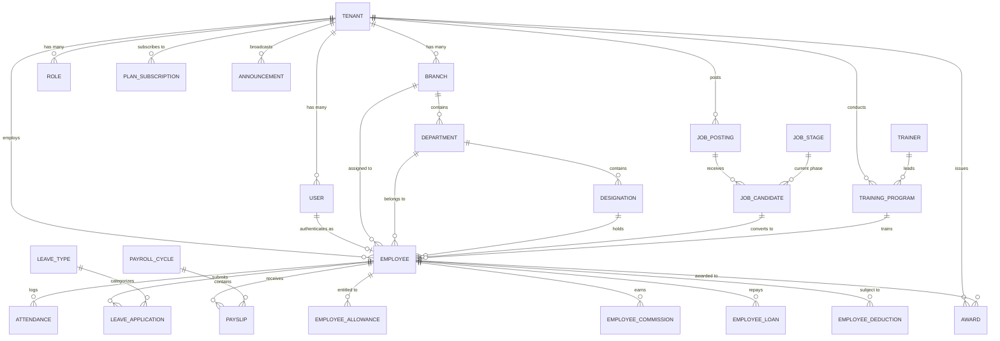

# 09. Conceptual Database Architecture and ER Diagram

This document reconstructs the conceptual data model of WorkDo HRMS based on decompiled Eloquent model relationships, Inertia response schemas, and form payload data. It compares this model against MASTERHRMS's 299 Prisma models to pinpoint exact schema gaps and mapping alignments.

---

## 1. High-Level Entity Relationship Diagram

The conceptual schema comprises 38 primary entities organized into 8 functional clusters.

---

## 2. Detailed Entity Catalog & Field Specifications

### 2.1 Multi-Tenancy & Authorization

#### `Tenant` / `Company`
- `id`: UUID / Primary Key
- `name`: String (e.g., "Acme Cloud ERP")
- `email`: String (Unique)
- `domain`: String (Subdomain / Custom domain)
- `plan_id`: Foreign Key -> `Plan`
- `plan_expire_date`: DateTime
- `is_active`: Boolean (Default: true)
- `created_at`, `updated_at`: DateTime

#### `Plan`
- `id`: UUID / Primary Key
- `name`: String (e.g., "Enterprise", "Standard")
- `price`: Decimal(10, 2)
- `duration`: Enum (`monthly`, `yearly`, `lifetime`)
- `max_users`: Integer
- `max_employees`: Integer
- `storage_limit`: Integer (in MB)
- `modules`: JSON (Enabled module flags)

#### `User`
- `id`: UUID / Primary Key
- `tenant_id`: Foreign Key -> `Tenant`
- `name`: String
- `email`: String
- `password_hash`: String
- `avatar`: String (Nullable)
- `is_active`: Boolean
- `created_at`, `updated_at`: DateTime

#### `Role` & `Permission`
- `Role`: `{ id, tenant_id, name, guard_name }`
- `Permission`: `{ id, name, module, guard_name }`
- `RoleHasPermissions`: `{ role_id, permission_id }`
- `UserHasRoles`: `{ user_id, role_id }`

---

### 2.2 Organizational Structure

#### `Branch`
- `id`: UUID / Primary Key
- `tenant_id`: Foreign Key -> `Tenant`
- `name`: String (e.g., "Main HQ", "San Francisco Branch")
- `created_at`, `updated_at`: DateTime

#### `Department`
- `id`: UUID / Primary Key
- `tenant_id`: Foreign Key -> `Tenant`
- `branch_id`: Foreign Key -> `Branch`
- `name`: String (e.g., "Human Resources", "Engineering")

#### `Designation`
- `id`: UUID / Primary Key
- `tenant_id`: Foreign Key -> `Tenant`
- `department_id`: Foreign Key -> `Department`
- `name`: String (e.g., "Senior Software Engineer", "HR Specialist")

---

### 2.3 Employee Core & Lifecycle

#### `Employee`
- `id`: UUID / Primary Key
- `tenant_id`: Foreign Key -> `Tenant`
- `user_id`: Foreign Key -> `User` (Nullable, linked if ESS active)
- `employee_code`: String (Unique per tenant, e.g., `#EMP0001`)
- `first_name`: String
- `last_name`: String
- `email`: String
- `phone`: String
- `dob`: Date
- `gender`: Enum (`male`, `female`, `other`)
- `address`: Text
- `branch_id`: Foreign Key -> `Branch`
- `department_id`: Foreign Key -> `Department`
- `designation_id`: Foreign Key -> `Designation`
- `joining_date`: Date
- `exit_date`: Date (Nullable)
- `salary_type`: Enum (`monthly`, `hourly`, `weekly`)
- `basic_salary`: Decimal(12, 2)
- `account_holder_name`: String
- `account_number`: String
- `bank_name`: String
- `bank_identifier_code`: String (IFSC / SWIFT)
- `tax_payer_id`: String (PAN / SSN)
- `status`: Enum (`active`, `on_leave`, `suspended`, `terminated`)

#### `EmployeeDocument`
- `id`: UUID / Primary Key
- `employee_id`: Foreign Key -> `Employee`
- `document_name`: String
- `file_path`: String
- `expiry_date`: Date (Nullable)

---

### 2.4 Time, Attendance & Leaves

#### `Attendance`
- `id`: UUID / Primary Key
- `tenant_id`: Foreign Key -> `Tenant`
- `employee_id`: Foreign Key -> `Employee`
- `date`: Date
- `status`: Enum (`present`, `absent`, `late`, `half_day`, `holiday`, `leave`)
- `clock_in`: Time / DateTime
- `clock_out`: Time / DateTime (Nullable)
- `late_minutes`: Integer (Default: 0)
- `early_leaving_minutes`: Integer (Default: 0)
- `overtime_hours`: Decimal(4, 2) (Default: 0)
- `total_rest_minutes`: Integer
- `created_at`, `updated_at`: DateTime

#### `LeaveType`
- `id`: UUID / Primary Key
- `tenant_id`: Foreign Key -> `Tenant`
- `title`: String (e.g., "Annual Leave", "Casual Leave", "Sick Leave")
- `days_per_year`: Integer
- `is_paid`: Boolean (Default: true)

#### `LeaveApplication`
- `id`: UUID / Primary Key
- `tenant_id`: Foreign Key -> `Tenant`
- `employee_id`: Foreign Key -> `Employee`
- `leave_type_id`: Foreign Key -> `LeaveType`
- `start_date`: Date
- `end_date`: Date
- `total_days`: Decimal(4, 1)
- `reason`: Text
- `status`: Enum (`pending`, `approved`, `rejected`)
- `action_by`: Foreign Key -> `User`
- `action_reason`: Text (Mandatory if rejected)

---

### 2.5 Payroll Engine Entities

#### `PayrollCycle`
- `id`: UUID / Primary Key
- `tenant_id`: Foreign Key -> `Tenant`
- `month`: Integer (1 - 12)
- `year`: Integer
- `status`: Enum (`draft`, `generated`, `locked`, `paid`)
- `total_basic`: Decimal(14, 2)
- `total_allowance`: Decimal(14, 2)
- `total_deduction`: Decimal(14, 2)
- `total_net_pay`: Decimal(14, 2)

#### `Payslip`
- `id`: UUID / Primary Key
- `tenant_id`: Foreign Key -> `Tenant`
- `payroll_cycle_id`: Foreign Key -> `PayrollCycle`
- `employee_id`: Foreign Key -> `Employee`
- `basic_salary`: Decimal(12, 2)
- `allowances`: JSON (Array of `{ title, amount }`)
- `commissions`: JSON (Array of `{ title, amount }`)
- `loans`: JSON (Array of `{ title, deduction_amount }`)
- `deductions`: JSON (Array of `{ title, amount }`)
- `overtime_pay`: Decimal(10, 2)
- `leave_deduction`: Decimal(10, 2)
- `gross_pay`: Decimal(12, 2)
- `net_pay`: Decimal(12, 2)
- `payment_status`: Enum (`unpaid`, `paid`)
- `paid_date`: DateTime (Nullable)

#### `EmployeeLoan`
- `id`: UUID / Primary Key
- `employee_id`: Foreign Key -> `Employee`
- `title`: String
- `loan_amount`: Decimal(12, 2)
- `monthly_deduction`: Decimal(10, 2)
- `remaining_balance`: Decimal(12, 2)
- `status`: Enum (`active`, `completed`)

---

### 2.6 Recruitment ATS & Training

#### `JobPosting`
- `id`: UUID / Primary Key
- `tenant_id`: Foreign Key -> `Tenant`
- `title`: String
- `branch_id`: Foreign Key -> `Branch`
- `category_id`: Foreign Key -> `JobCategory`
- `open_positions`: Integer
- `status`: Enum (`active`, `inactive`, `closed`)
- `job_description`: Text
- `requirements`: Text

#### `JobCandidate`
- `id`: UUID / Primary Key
- `tenant_id`: Foreign Key -> `Tenant`
- `job_posting_id`: Foreign Key -> `JobPosting`
- `stage_id`: Foreign Key -> `JobStage` (Applied, Screening, Interview, Offered, Hired)
- `name`: String
- `email`: String
- `phone`: String
- `resume_url`: String
- `rating`: Integer (1 - 5)
- `notes`: Text

---

## 3. MASTERHRMS Prisma Schema Alignment Analysis

MASTERHRMS's `prisma/schema.prisma` already contains **299 models**. The following analysis details existing coverage vs. gaps to align:

| Functional Cluster | WorkDo Entity Concept | MASTERHRMS Prisma Model | Alignment Status | Action Needed |
|---|---|---|---|---|
| **Tenancy** | `Tenant` | `Tenant` (in Prisma) | Exact Match | None; fully aligned |
| **Auth** | `User`, `Role`, `Permission` | `User`, `Role`, `Permission` | Exact Match | None; fully aligned |
| **Org Structure** | `Branch`, `Department`, `Designation` | `Branch`, `Department`, `Designation` | Exact Match | None; fully aligned |
| **Employee** | `Employee` | `Employee` | 95% Match | Add `salary_type` enum field if missing |
| **Attendance** | `Attendance` | `AttendanceRecord` | 90% Match | Add explicit `overtime_hours`, `late_minutes` columns |
| **Leaves** | `LeaveType`, `LeaveApplication` | `LeaveType`, `LeaveRequest` | Exact Match | Minor field name mapping (`LeaveRequest`) |
| **Payroll Engine**| `Payslip`, `PayrollCycle` | `PayrollCycle`, `PayrollEntry` | 85% Match | Wire overtime & unpaid leave formula into `PayrollEntry` |
| **Salary Details**| `EmployeeLoan`, `Allowance` | `SalaryStructure`, `SalaryItem` | 75% Match | Map WorkDo 6-component breakdown to `SalaryItem` |
| **Recruitment ATS**| `JobPosting`, `JobCandidate` | Partial (`JobOpening`, `Candidate`) | 50% Match | Check Prisma models; add Kanban `JobStage` relations |
| **Awards / Comms**| `Award`, `Announcement` | Missing / Separate models | Missing | Add `Announcement` and `Award` Prisma models |
