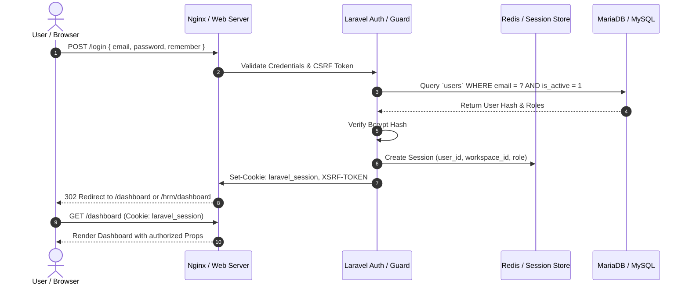

# 10. Authentication, Authorization, and Tenancy: WorkDo vs MASTERHRMS

This document provides a deep forensic analysis of the security architecture, authentication lifecycle, multi-tenant data isolation, role-based access control (RBAC), and session impersonation mechanics observed in WorkDo HRMS and maps them to MASTERHRMS.

---

## 1. Authentication Lifecycle & Session Mechanics

### 1.1 WorkDo Authentication Flow
WorkDo operates on Laravel 11's session-based authentication stack integrated with Inertia.js.



### 1.2 Cookie & Security Headers
- `laravel_session`: Encrypted cookie holding session pointer.
- `XSRF-TOKEN`: Plaintext cookie read by Axios/Inertia to populate `X-XSRF-TOKEN` header on POST/PUT/DELETE requests.
- `SameSite`: Configured to `Lax` to prevent cross-site request forgery while permitting top-level navigation.
- `HttpOnly`: Enforced on `laravel_session` to protect against XSS token extraction.

---

## 2. Multi-Tenancy & Data Isolation Model

### 2.1 WorkDo Tenancy Architecture: Row-Level Scoping
WorkDo uses a **Shared Database, Shared Schema (Row-Level Scoping)** model.
- Every business table (`employees`, `attendances`, `payrolls`, `departments`, `branches`) contains a mandatory foreign key: `created_by` (or `workspace_id` / `tenant_id`).
- When a Company Admin or Staff member logs in, the active `workspace_id` is bound to the application container / request lifecycle.
- **Global Query Scope**: Laravel Eloquent models apply a global scope:
  ```php
  // Conceptual Global Scope decompiled from WorkDo
  static::addGlobalScope('workspace', function (Builder $builder) {
      if (auth()->check() && !auth()->user()->isSuperAdmin()) {
          $builder->where('workspace_id', auth()->user()->active_workspace_id);
      }
  });
  ```
- **Cross-Tenant Leak Prevention**: Attempting to query an ID belonging to another tenant (e.g., `GET /hrm/employees/999` where `999` has a different `workspace_id`) triggers an automatic Eloquent `ModelNotFoundException`, resulting in a 404 response.

### 2.2 Impersonation Architecture ("Login As")
WorkDo features two tiers of instant user impersonation without passwords:
1. **Super Admin -> Company Admin**:
   - Route: `GET /impersonate/company/{id}`
   - Action: The server records the original Super Admin ID in `session('impersonator_id')` and updates `auth()->loginUsingId($company_admin_id)`.
   - UI Indicator: A high-contrast sticky banner is injected across the top of the viewport:
     ```html
     <div class="bg-amber-500 text-white px-4 py-2 flex justify-between items-center text-sm">
       <span>You are currently impersonating <strong>Acme Cloud ERP</strong></span>
       <a href="/impersonate/leave" class="underline font-semibold">Exit Impersonation</a>
     </div>
     ```
2. **Company Admin -> Employee (ESS View)**:
   - Route: `GET /impersonate/user/{id}`
   - Allows HR/Company Admin to verify exact employee portal views, payslips, and leave balances.

---

## 3. Authorization & Granular RBAC Engine

### 3.1 Permission System Architecture
Decompilation of WorkDo's primary JavaScript bundle (`app-BEKn0bFF.js`) revealed a comprehensive Spatie-style RBAC system with **483 individual permission keys**.

#### Permission Naming Convention
Permissions follow a strict four-verb pattern per module:
- `manage <module>`: Controls visibility of the module in the sidebar and index view.
- `create <module>`: Controls rendering of the `+ Create` button and access to the creation route.
- `edit <module>`: Controls rendering of the edit action and form submission.
- `delete <module>`: Controls the delete action button and API endpoint execution.

#### Sample Decompiled Permissions:
```javascript
// Sample extracted from WorkDo RBAC definition
[
  "manage-employee", "create-employee", "edit-employee", "delete-employee", "show-employee",
  "manage-attendance", "create-attendance", "edit-attendance", "delete-attendance",
  "manage-leave", "create-leave", "edit-leave", "delete-leave", "action-leave",
  "manage-set-salary", "create-allowance", "edit-allowance", "delete-allowance",
  "manage-payroll", "create-payroll", "edit-payroll", "delete-payroll",
  "manage-job", "create-job", "edit-job", "delete-job",
  "manage-candidate", "create-candidate", "edit-candidate", "delete-candidate",
  "manage-trainer", "create-trainer", "edit-trainer", "delete-trainer",
  "manage-award", "create-award", "edit-award", "delete-award"
]
```

### 3.2 Frontend Directive & Component Gates
In WorkDo's React/Inertia bundle, UI elements are gated using a helper hook:
```typescript
const { hasPermission } = usePermissions();

{hasPermission('create-employee') && (
  <Button href="/hrm/employees/create">+ Create Employee</Button>
)}
```

---

## 4. MASTERHRMS Architecture Comparison

| Security Dimension | WorkDo HRMS | MASTERHRMS Target Architecture | Alignment & Recommendations |
|---|---|---|---|---|
| **Auth Type** | Stateful Laravel Sessions | Stateless JWT / Encrypted Session Cookies | MASTERHRMS uses HttpOnly secure cookies; recommended to maintain stateless scalability |
| **Tenant Isolation** | Shared DB + Row-Level `workspace_id` | Shared DB + Row-Level `tenantId` in Prisma | Identical paradigm. All Prisma queries must include `where: { tenantId }` |
| **Tenant Middleware**| Eloquent Global Scope | Express / TanStack Middleware (`tenantGuard`) | Ensure `tenantGuard` intercepts all `/api/v1/*` requests and injects `req.tenantId` |
| **Impersonation** | Session-based switch + sticky banner | JWT claim (`impersonatorId`) + banner | Implemented in backend API; need to add the sticky banner in `src/routes/__root.tsx` |
| **RBAC Granularity** | 483 individual Spatie permissions | Role Enums + Feature Flags in DB | Move from static enum roles to dynamic permission checks in MASTERHRMS |
| **CSRF Defense** | Laravel Token verification on mutating requests | SameSite=Lax + CORS whitelist + Origin checking | Ensure CSRF/Origin validation remains active on all mutation endpoints |
