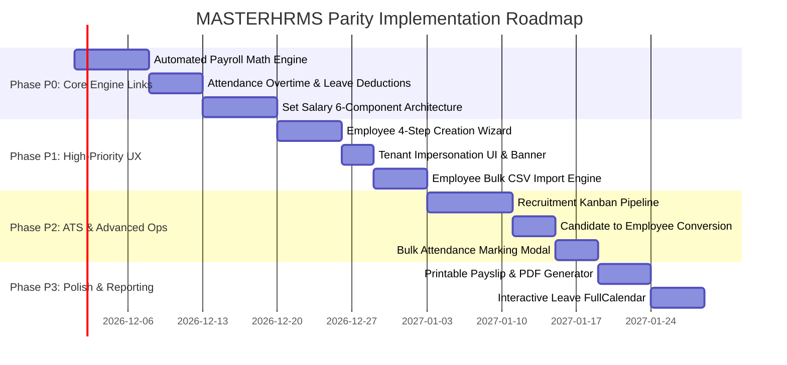

# 13. Role and Module Implementation Roadmap

This document provides an actionable, prioritized engineering roadmap to bridge the functional and architectural gaps between WorkDo HRMS and MASTERHRMS. Work is structured into four distinct phases (P0 to P3) with specific target file paths, schema updates, API endpoints, and acceptance criteria.

---

## 1. Roadmap Overview & Timeline



---

## 2. Phase P0: Core Payroll Engine & Mathematical Automation (Critical)

### Objective
Unify Attendance, Leave Management, and Payroll into a single automated pipeline matching WorkDo's exact mathematical engine while preserving Indian statutory compliance.

### 2.1 Schema Updates (`prisma/schema.prisma`)
Add granular salary component models and loan tracking:
```prisma
model EmployeeSalaryComponent {
  id           String   @id @default(uuid())
  tenantId     String
  employeeId   String
  category     String   // ALLOWANCE | COMMISSION | DEDUCTION | OTHER
  title        String
  type         String   // FIXED | PERCENTAGE
  amount       Decimal  @db.Decimal(10, 2)
  isRecurring  Boolean  @default(true)
  createdAt    DateTime @default(now())
  
  employee     Employee @relation(fields: [employeeId], references: [id], onDelete: Cascade)
}

model EmployeeLoan {
  id               String   @id @default(uuid())
  tenantId         String
  employeeId       String
  title            String
  loanAmount       Decimal  @db.Decimal(12, 2)
  monthlyDeduction Decimal  @db.Decimal(10, 2)
  remainingBalance Decimal  @db.Decimal(12, 2)
  status           String   @default("ACTIVE") // ACTIVE | COMPLETED
  createdAt        DateTime @default(now())
  
  employee         Employee @relation(fields: [employeeId], references: [id], onDelete: Cascade)
}
```

### 2.2 Backend Service Implementation
- **File**: `server/src/services/payrollCalculationService.ts`
- **Logic**:
  1. Fetch base salary and active `EmployeeSalaryComponent` items.
  2. Query `AttendanceRecord` for the period: compute total overtime hours -> calculate `Attendance OT Pay`.
  3. Query `LeaveRequest` where `status = "APPROVED"` and `LeaveType.isPaid = false`: compute unpaid days -> deduct `(unpaidDays * dailyRate)`.
  4. Query active `EmployeeLoan`: deduct `monthlyDeduction` and decrement `remainingBalance`.
  5. Compute Indian statutory deductions (EPF, ESIC, PT, TDS).
  6. Output final `grossPay` and `netPay`.

### 2.3 UI Implementation
- **File**: `src/routes/_authenticated/hr/payroll/`
- Refactor the salary configuration view to include the 6 collapsible WorkDo-style accordions: Basic Salary, Allowances, Commissions, Loans, Saturation Deductions, and Overtime Rates.

### 2.4 Acceptance Criteria
- [ ] Generating monthly payroll for an employee with 2 unpaid leave days automatically reduces gross pay by exactly 2 daily rates.
- [ ] Overtime hours logged in attendance records automatically appear as a positive addition line item in the generated payslip.
- [ ] Active loans automatically deduct the monthly installment and decrement the remaining balance.

---

## 3. Phase P1: High-Priority UX & Operational Parity (High)

### Objective
Implement the 4-step Employee Creation Wizard, Tenant Impersonation UI banner, and bulk CSV import.

### 3.1 Components & Routes to Build/Update
1. **Employee Creation Wizard**:
   - **Target File**: `src/routes/_authenticated/hr/employees/new.tsx`
   - **Structure**: 4 sequential steps with Stepper header:
     - Step 1: Personal Details (`name`, `email`, `phone`, `dob`, `gender`, `address`)
     - Step 2: Company Details (`branchId`, `departmentId`, `designationId`, `joiningDate`, `userAccountToggle`)
     - Step 3: Financial Details (`salaryType`, `basicSalary`, `bankName`, `accountNumber`, `ifscCode`, `pan`)
     - Step 4: Documents Upload (`idProof`, `resume`, `offerLetter`)
2. **Tenant Impersonation Banner**:
   - **Target File**: `src/routes/__root.tsx`
   - Sticky top banner displaying active impersonated tenant name and "Exit Impersonation" action button.
3. **CSV Bulk Import**:
   - **Target File**: `src/routes/_authenticated/hr/employees/index.tsx`
   - Modal with file dropzone, CSV template download, and schema validation preview before committing to database.

### 3.2 Acceptance Criteria
- [ ] HR can complete employee creation via a validated 4-step wizard with step-by-step Zod validation.
- [ ] Toggling "Create User Account" in Step 2 automatically provisions a linked auth user.
- [ ] Super Admin clicking "Login As" on a tenant enters the tenant view with a high-contrast return banner.

---

## 4. Phase P2: Recruitment ATS & Bulk Attendance (Medium)

### Objective
Deliver the drag-and-drop Candidate Kanban board, one-click Candidate to Employee conversion, and mass attendance marking.

### 4.1 Implementation Tasks
1. **Recruitment Kanban Pipeline**:
   - **Target File**: `src/routes/_authenticated/hr/recruitment/candidates/index.tsx`
   - Integrate `@hello-pangea/dnd` or Radix-based DnD for stages: *Applied*, *Screening*, *Interview*, *Offered*, *Hired*.
   - Dragging a card triggers PATCH mutation to update `candidate.stageId`.
2. **Candidate to Employee Conversion**:
   - Action button on *Offered* or *Hired* candidate cards.
   - Redirects to `/hr/employees/new` with candidate name, email, phone, and resume pre-filled into wizard state.
3. **Bulk Attendance Marking**:
   - **Target File**: `src/routes/_authenticated/hr/attendance/index.tsx`
   - Modal allowing HR to select Date, Branch, and Status (*Present*/*Absent*), performing batch insert via `prisma.attendanceRecord.createMany()`.

### 4.2 Acceptance Criteria
- [ ] Candidates can be dragged smoothly between interview stages with instant DB synchronization.
- [ ] Clicking "Convert to Employee" loads the employee wizard pre-populated with candidate information.
- [ ] HR can mark an entire branch present for a given day in under 3 clicks.

---

## 5. Phase P3: Visual Polish & Enhanced Analytics (Polish)

### Objective
Elevate UI presentation to match WorkDo's clean aesthetics, including printable payslips and interactive calendars.

### 5.1 Tasks
1. **Printable Payslip Layout**:
   - **Target File**: `src/routes/_authenticated/hr/payroll/slips/$id.tsx`
   - Apply clean `@media print` styles and PDF download action via `@react-pdf/renderer` or backend Puppeteer/DomPDF stream.
2. **Interactive Leave Calendar**:
   - **Target File**: `src/routes/_authenticated/hr/leave/calendar.tsx`
   - Implement FullCalendar or TanStack-compatible grid rendering approved leaves as color-coded event chips.

### 5.2 Acceptance Criteria
- [ ] Payslips print cleanly onto a single A4 page with company header, employee details, two-column earnings/deductions table, and signature line.
- [ ] Calendar view accurately displays team leaves with department filters.
