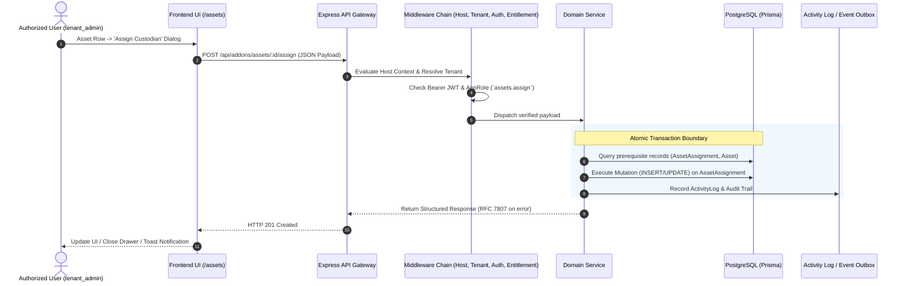

# Function Report: Custodian Allocation & Acceptance Sign-off

**Function ID:** FN-046  
**Canonical Name:** Custodian Allocation & Acceptance Sign-off  
**Module:** Asset Management Add-on (`Custodian`)  
**Phase:** PHASE-1  
**Operational Status:** **COMPLETED & FULLY IMPLEMENTED**
**Investigation Date:** November 20, 2026 (Verified)

---

## 1. Requirement & Business Purpose
- **Original Requirement:** Enable seamless, compliant enterprise execution of Custodian Allocation & Acceptance Sign-off across multi-tenant workspace environments.
- **Business Purpose:** Delivers transactional capability for Custodian Allocation & Acceptance Sign-off within the Asset Management Add-on domain.
- **Workflow Dependency:** Available Asset, Active Employee.

---

## 2. Trigger & Execution Architecture
- **Trigger Type:** User Action / Scheduled Event.
- **Frontend Entry Point:** `/assets` -> Asset Row -> 'Assign Custodian' Dialog.
- **Backend API Contract:**
  - **Endpoint:** `/api/addons/assets/:id/assign`
  - **HTTP Method:** `POST`
  - **Tenant Scoped:** `true`
- **RBAC Permissions Required:** `assets.assign`
- **Authorized Roles:** `tenant_admin`, `it_admin`.

---

## 3. Execution Sequence & Data Flow

---

## 4. Database Models & Schema Interactions
- **Primary Database Models:** `AssetAssignment`, `Asset`, `Employee`
- **Tenant Isolation Policy:** All queries automatically enforce `tenantId` scoping via `tenantStorage` (`server/src/context/tenant-context.ts`).
- **Transaction Boundaries:** Wrapped in `prisma.$transaction()` to ensure full atomicity and rollback on partial failure.

---

## 5. Security, Idempotency & Error Handling
- **Idempotency:** Mutations utilize unique constraint checking and client-generated idempotency keys where applicable.
- **Rollback Behavior:** Complete transaction abort on database constraint violation or external service timeout.
- **Audit Logging:** Emits structured audit entry in `activity_logs` table capturing `user_id`, `action: "Custodian Allocation & Acceptance Sign-off"`, IP address, and timestamp.
- **Security Validation:** Parameterized queries, schema sanitization, and XSS defense.

---

## 6. Verification & Forensic Evidence
- **Forensic Evidence:** assets.routes.ts line 130; locks asset and records custodian assignment.
- **UI Status:** **WORKING**
- **API Status:** **WORKING**
- **Database Status:** **WORKING**
- **Known Issues:** None observed.
